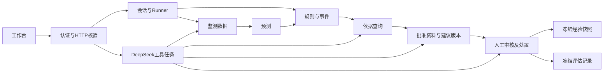

# 模块职责、接口与调用关系

基础版采用一个FastAPI进程、SQLAlchemy存储和Vue工作台。监测值单独索引，其余业务记录按类型和编号存储；服务共享事务入口。当前以SQLite验收，PostgreSQL通过连接配置启用。

| 模块 | 职责 | 主要接口 | 调用 |
| --- | --- | --- | --- |
| auth | 账号、口令散列、令牌散列与工作面/角色授权 | login/get_actor/authorize/logout | 全部HTTP入口 |
| data | 数据源/点位、文件、历史导入、现场标准读数、质量及时钟查询 | import_history/ingest_readings/query_series | store |
| sessions | 会话模式、状态和单调数据时钟 | create_session/apply_action/get_context | data目录 |
| prediction | 不可变模型版本、闭合输入窗口、预测适配与运行记录 | register_model/run_prediction/get_forecast | data |
| alerts | 团队草案规则、实测/预测事件、不可变事件修订 | evaluate_observed/evaluate_forecast/query_events | data/预测结果 |
| traceability | 冻结事件对应的观测、规则和模型依据，附带候选溯源 | get_event_evidence | alerts/data/prediction/溯源适配器 |
| knowledge | 原文页段、审核、检索、建议内容版本、经验 | import_reference/search_documents/draft_advice | 服务端依据及批准引用 |
| cases | 人工确认、建议审核事实、执行/反馈/复核及冻结快照 | record_action/get_case/export_reviewed_case | alerts/knowledge |
| agent | DeepSeek八工具对话、事件主动简报、上下文隔离与审计 | chat/submit/get_task/cancel_task；event_briefs.submit/get/cancel | 对话沿用八工具；主动简报限定四个只读工具 |
| evaluation | 冻结清单、事件一对一匹配、分子分母和报告 | freeze_manifest/build_report/get_report | 冻结导出记录 |
| frontend | 会话、曲线、依据、资料及人工闭环、对话、评估 | /api/* | HTTP API |

`sessions/runner.py`组合一次时钟推进，计算观测预警和可用预测。相同会话、时钟、配置、模型清单及可见数据数量的重复推进复用结果。

八工具为query_series、run_prediction、get_forecast、query_events、get_event_evidence、search_documents、draft_advice、get_case。身份、来源和数据时钟由服务端注入，工具参数通过禁止多余字段的JSON Schema校验；上限5轮、12次调用。检索原文作为资料输入，审计保留名称、参数、状态、耗时和出处。

查询要求event_time和available_at均不晚于as_of，范围[start_at,end_at)。模型读取连续有效、来源允许的闭合时间桶。基线明确标记，专业浓度规则只采用residual_corrected物理浓度输出。

事件记录revision_as_of逻辑时钟；人工操作同时记录真实occurred_at和数据data_as_of。建议内容保存在knowledge，审核事实保存在cases。经验由已复核快照生成，继承演练/现场性质；现场检索过滤演练经验。

运行服务的/openapi.json列出实际HTTP接口，包含上传、目录、标准现场接收及基础方案兼容路径。HTTP监测导入只接受上传编号，文档文件读取须由可信本地调用配置允许目录。

专业模型首轮训练、产物登记及六通道加工数据接入已完成；模型效果与聚类问题见[训练与聚类验算](training-and-clustering-audit-20261103.md)。后续集成项包括模型改进与真实成因标签、现场系统协议、矿井有效预案和经确认的单位/规则。

## 专业模型封装

`gas_forecast` 封装 FEDformer＋12阶段 LightGBM 残差模型；`gas_attribution` 封装六通道 KMeans/SVC 候选溯源。两者通过 `ModelRuntime` 在独立 Python 环境执行，受信任的本地目录清单绑定模型版本、来源及工作面。路径和运行命令由本地配置提供。

`GET /api/model-packages` 查看当前会话适用的模型及实验状态；`POST /api/model-package-runs` 提交准备好的特征；`GET /api/model-package-runs/{run_id}` 查询本会话运行。准备特征入口记录 `submitted_features`；常规专业预测由 `TrainedModelsPipeline` 构造同训练定义的特征，记录 `server_observations` 和输入行引用。

现有SVC自动溯源已启用。`GET /api/evidence` 对实测事件中首个达到模型阈值0.65的观测构造输入，输入截止于目标时刻之前300秒，读取截至该时间的61个连续分钟时刻、共366条六通道观测。结果保存在 `attribution_run`，证据响应附带 `candidate_attribution`。同会话、事件修订、模型版本及特征配置复用已保存的运行；事件修订变化后重新计算。当前触发点为依据查询，Runner仍负责预测和预警。

依据追溯继续使用 `traceability`；候选溯源的类别概率为聚类成员概率。输入合同、产物导出及调用命令见[模型封装说明](model-packaging.md)。

前端联动、主动简报、知识与人工处置、竞赛回放和现场接入的阶段要求见[整体模块设计 v0.6](module-design-v0.6.md)。

## 正式前端联动

深蓝Vue工作台通过 `GET /api/sources/{source_id}/coverage` 选择实际历史时段，通过 `GET /api/forecasts` 恢复当前会话、测点和模型版本的最新预测。`POST /api/forecasts` 接受可选 `version`，与模型选择保持一致。事件依据请求绑定 `event_revision`，实测事件可同时展示适用预测和候选溯源。工况测点沿用数据查询，页面不启动甲烷预测和规则请求。

前端请求同时校验代次与会话、来源、测点、数据时钟，切换后清空旧结果。监测卡和曲线保持同一可见性口径，预测区间显示其起算及结束时间。实现与验收见[前端联动说明](frontend-linkage.md)。

## 新预警主动简报

Runner在事件持久化后，对新事件或等级升级原子认领自动触发记录，再提交后台简报。同等级普通修订、重复及并发推进复用触发记录。`EventBriefsService`属于现有agent模块，保存事件冻结版本和任务；读取依据后使用四个只读工具生成正文，保留真实步骤与引用。

`GET/POST /api/events/{event_id}/brief`读取或生成指定修订简报；`POST /api/events/{event_id}/brief/cancel`取消任务。GET可回退同等级的较早可见简报，并返回实际版本、请求版本及stale标记。共享读取保持工作面、来源、会话和时钟限制，普通聊天不得改写简报任务。取消和重启中断同步结束未完成工具步骤。

真实来源外发受本地允许名单约束，默认关闭；未授权保留本地工具依据。具体行为、接口和字段见[主动简报说明](event-briefs.md)及[拟外发字段](event-brief-cloud-fields.md)。登录页面及原认证入口保持现状。
