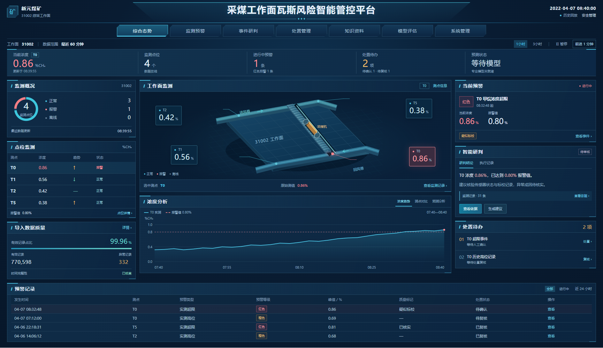
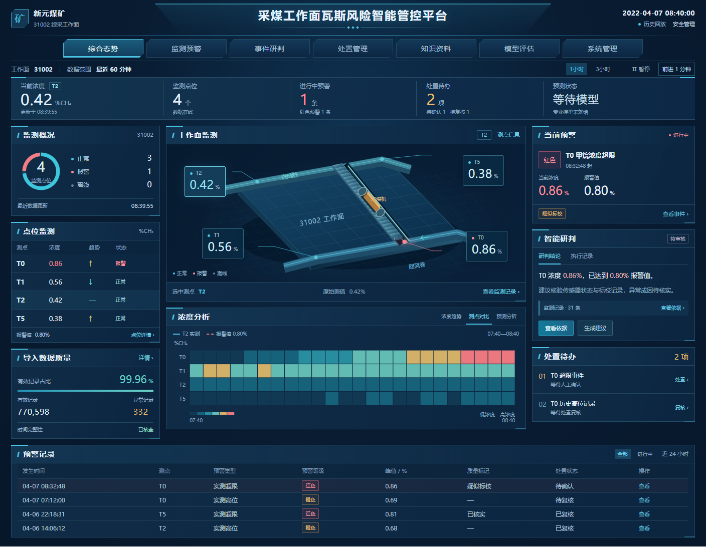

# 前端设计 v0.2（待审核）

本次沿用用户选定的深蓝配色，重做行业大屏的布局、展示层次和业务文案。正式Vue页面继续以用户审核为下一步。

## 设计依据

- [云鼎科技综合管控平台](https://www.yundingkeji.cn/page/552536964696376453)：居中系统标题、顶部业务导航、分层深蓝底色、青色短线和专业信息分区。
- [空间维特综合管控平台](https://www.spacewiot.com/pd.jsp?id=14)：中部主场景、两侧监测信息与事件联动。
- [中国煤科公开材料，第59页瓦斯监测数据分析预警界面](https://www.chinamine-safety.gov.cn/fw/ksaqkj/zjjz/202411/W020241113369889508016.pdf)：专业监测分区、测点时序对比、历史/实时切换和分层分析入口。

## 布局

顶部为矿井/工作面、居中平台标题、数据时钟与角色；下方整行导航和紧凑状态带。

主体采用约22%/54%/24%的三列：

- 左：监测概况、测点浓度/趋势/状态、导入数据质量。
- 中：工作面、巷道、支架与采煤机布置视图；测点选择联动浓度趋势、测点对比和预测分析。
- 右：当前预警、智能研判、执行记录、处置待办。
- 下：跨列预警记录表，提供进行中筛选和事件入口。

使用蓝色分层背景、较窄面板间距、标题短青线、轻量折角导航及对齐的表格。红色对应报警，青色对应监测和选中状态，橙色对应待办与质量标记。选中正常测点保留青色，不以红色表达选中状态。

## 文案

界面仅保留业务名称、量值、时间、状态和操作；删除设计性质标记、流程口号和解释页面布局的文字。未就绪、待审核、疑似标校等真实业务状态继续保留。

## 交互

点击点位表或场景测点更新选中值与曲线；浓度分析可切换趋势、测点时序对比和预测区间；预警记录可筛选进行中事件；智能研判可查看执行记录、原始依据及建议状态；处置入口可展开事件、确认、复核与资料。

## 资料与实施边界

本稿用于审核页面，显示数据和事件为设计占位内容；数据质量总量取自已核查的T0导入统计。场景为界面布置插画，尚未绑定实际矿图或监测坐标；巷道、设备及传感器图形不构成真实位置映射。上述说明保存在设计文件中，界面按用户要求使用业务文案。

正式实施时，测点、量纲、时间、事件、设备状态和模型结果按已有接口绑定；资料不足的状态使用对应业务状态，预测曲线等待实际模型输出。

## 检查

已检查1920、1440、1024、736、390宽度；交互检查覆盖测点联动、对比图、模型未就绪、事件筛选、执行记录、依据、人工确认及建议资料状态。页面脚本无异常，未出现指定的说明性文字。

