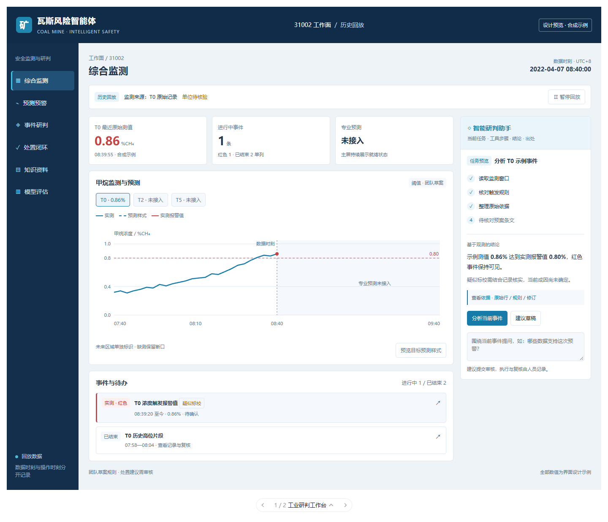
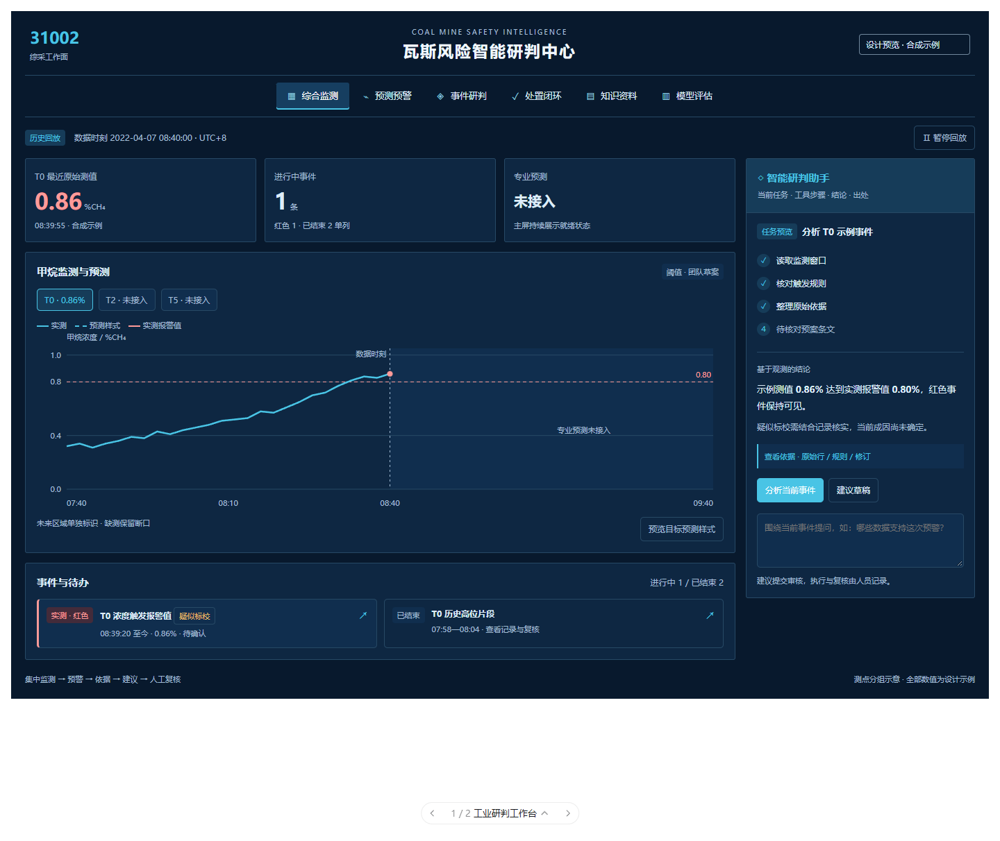

# 前端设计提案 v0.1（待用户审核）

本稿用于审核风格、页面结构和交互，正式前端保持当前版本。示例界面中的数值、事件和工具进度均为合成设计数据。

## 行业参考与取舍

已查看云鼎科技综合管控平台、空间维特智慧矿山综合管控平台的公开产品页和界面图片。

| 参考 | 观察 | 本项目采用方式 |
| --- | --- | --- |
| [云鼎科技综合管控平台](https://www.yundingkeji.cn/page/552536964696376453) | 深蓝底色、青色强调、顶部业务导航、监测和安全信息分区；产品强调一张图和业务流程联动 | 统一工作面与时钟，监测曲线、预警、依据和处置联动 |
| [空间维特智慧矿山综合管控平台](https://www.spacewiot.com/pd.jsp?id=14) | 中部空间场景、两侧监测图表、事件队列，强调矿山全局态势 | 借鉴主次布局和监测/事件的集中展示；本项目主屏用浓度趋势替代未取得真实图纸的空间场景 |

风格判断来自上述公开界面样本，作为设计参考。

## 两个方案

**工业研判工作台：**深蓝导航与顶栏、浅灰业务背景、白色内容区、蓝青色数据曲线。左侧业务导航，中部趋势与事件，右侧为智能体任务。适合连续操作、资料阅读和人工审核。

**安全态势指挥屏：**全深蓝业务界面、顶部模块导航、集中数据时钟、更大的趋势区域、并排事件队列和右侧智能研判。适合比赛投屏和集中展示。

两版共享业务结构，用户选定主风格后再落实正式页面。

### 工业研判工作台

### 安全态势指挥屏

## 页面与入口

| 页面 | 内容 |
| --- | --- |
| 综合监测 | 工作面、来源、实时/回放、数据时钟、最近原始值及时间、进行中事件、专业预测状态、实测与预测区域、事件待办 |
| 预测预警 | 就绪状态、缺失输入、浓度预测与决策分值、预测时段、模型及规则版本 |
| 事件研判 | 事件修订、触发条件、原始监测、质量标记、条件提示、资料出处；按同一事件组织 |
| 处置闭环 | 确认事件→审核建议→记录执行→反馈→复核；突出下一步操作与演练/现场性质 |
| 知识资料 | 原文页段、资料版本、适用工作面、批准状态、演练与现场经验来源 |
| 模型评估 | 模型登记和适用点位、基线标记、冻结评估段、指标分子分母及标校两套口径 |

智能体从聊天框扩展为“任务—步骤—结论—出处—动作”的工作区。工具结果关联监测、预测运行、事件修订和原始行号；人工审核与现场执行保留独立操作入口。

## 显示规则

- 最近原始值与最近闭合时间桶均值分别命名，显示各自时间和新鲜度。
- 进行中、已结束、待处置分别统计。历史红色事件保留记录状态。
- 同轴展示实测与预测，数据时钟划分过去与未来。时间轴保持线性，缺测保留断口。
- 默认样稿按专业模型未就绪状态显示；“目标预测样式”仅用于审核曲线视觉，标为合成示例。
- 物理浓度与决策分值分开命名、量纲和用途。
- 疑似标校和红色事件并列。成因结论展示已有依据和待核实项。
- 待接入点位显示“未接入”，模型缺失显示具体缺项；连接异常显示可辨识错误状态。
- 当前未取得空间坐标和实际矿图，首版采用测点分组；取得图纸后再设计空间定位视图。

## 现有前端实施时需修正

现有首页读取60秒聚合值却标作“最近有效实测值”；当前事件数包含已结束事件；专业预测状态不在首页；助手读取brief_method，而后端字段为method。正式改版时同步修正这些语义与字段。

## 设计稿验收

交互预览覆盖六个业务入口、事件切换、依据入口、建议与审核预览、专业模型缺项、当前状态/目标预测样式切换。已检查1024、736、390宽度，无横向溢出及脚本异常。当前原型不调用业务API。

原型片段：mining-ui-review.html；截图和检查记录保存在F盘项目documents/design-review/v0.1。

## 待用户把关

确定主视觉选择（工业工作台/深蓝指挥屏）、信息密度与字号、智能体占宽，以及比赛是否需要独立投屏模式。审核后再改正式Vue页面和接入已有接口。
