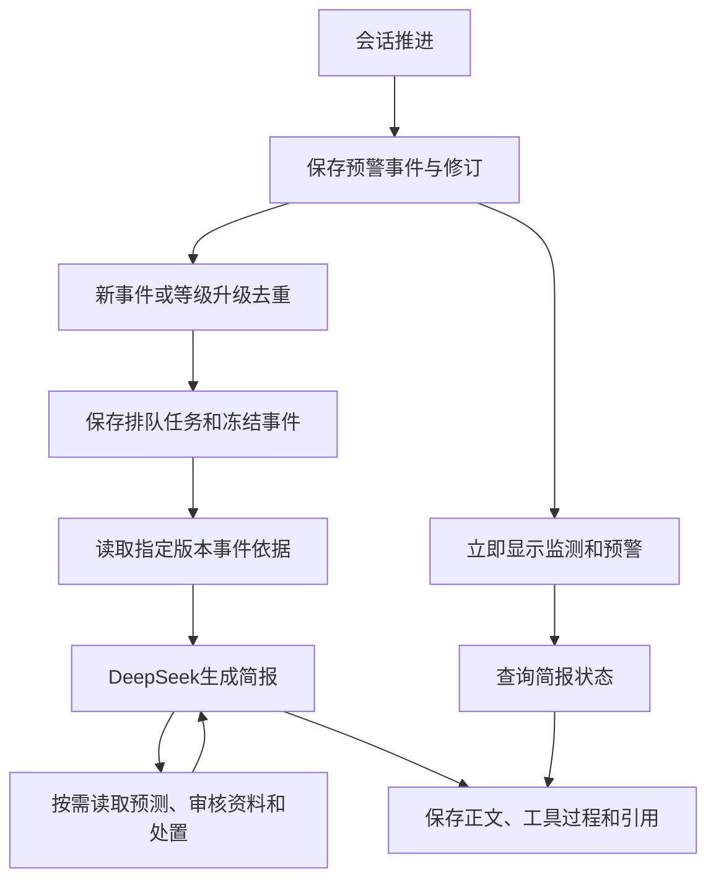

# 新预警主动研判简报

日期：2026-11-03。对应[整体方案](module-design-v0.6.md)第二阶段，沿用现有工作台和登录机制。

## 触发与调用

会话推进产生新预警，或已有事件的等级升高后，Runner先保存事件，再提交后台简报任务。监测、预测和事件结果先返回页面，DeepSeek在后台生成简报。

同会话、来源、事件和等级的自动触发只提交一次。普通事件修订、重复推进及并发推进复用已有触发记录；用户显式生成当前修订和失败重试分别处理。



任务固定事件编号、修订版本、来源和数据截止时间。首先执行 `get_event_evidence`，之后向DeepSeek提供四个只读工具：

| 工具 | 内容 |
| --- | --- |
| get_event_evidence | 当前事件指定修订的观测、规则、候选溯源及关联预测 |
| get_forecast | 当前会话、来源、事件测点及截止时间内的已保存预测 |
| search_documents | 当前工作面适用的已审核资料及页段定位 |
| get_case | 当前事件的处置阶段与待办 |

简报流程读取已有预测，不重新运行预测，不创建建议草稿或人工动作。最多5轮模型请求、12次工具调用，轮次开始前检查执行时间预算。网络超时和重试沿用现有DeepSeek配置。

## 任务与依据

状态为 `not_started/queued/running/completed/partial/failed/cancelled`。工具执行开始即保存步骤，记录名称、参数、状态、起止时间和耗时；执行结束保存对应结果卡。

已授权来源可向DeepSeek发送事件事实、观测统计及有限片段、模型候选和审核资料摘要。完整观测引用、366条溯源输入等保存在本地任务结果中。发送前筛选字段并处理本机路径及密钥样式文本。

`EVENT_BRIEF_ALLOWED_SOURCE_IDS`默认为空列表。来源未授权时只读取本地依据，任务返回 `cloud_source_not_authorized`，不会构造模型连接。真实来源的具体范围见[拟外发字段](event-brief-cloud-fields.md)，确认后再写入私有配置；未授权的其他来源保持关闭。

正文引用使用服务端分配的 `[E1]` 等编号，只能引用实际工具结果。未知引用、缺少引用或服务失败进入可重试状态，已读取的依据和工具步骤保留。缺少已审核规程时，简报说明资料缺项并列出核实事项。

引用类别包括事件、规则、原始观测、预测、候选溯源和已审核资料。点击引用可以查看冻结事件修订、原始行与文件标识、预测区间，或指定资料版本的原文页段。

同等级事件更新后，页面可展示已生成的较早修订简报，明确标注“基于第X版 · 当前第Y版”和数据截止时间；“生成当前版本”创建所选修订的新任务。等级变化后不沿用旧等级简报。

## 接口

| 接口 | 行为 |
| --- | --- |
| `POST /api/sessions/{session_id}/tick` | 既有推进接口，返回 `briefs` 触发引用，后台生成新事件或升级事件简报 |
| `GET /api/events/{event_id}/brief?session_id=...&event_revision=...` | 读取简报，不发起模型请求；返回实际简报修订、所选修订、stale状态及任务 |
| `POST /api/events/{event_id}/brief` | 请求生成或重试，body为 `{session_id,event_revision?,retry?:false}` |
| `POST /api/events/{event_id}/brief/cancel` | 取消指定简报修订，body为 `{session_id,event_revision?}` |

响应包含 `event_id/event_revision/requested_event_revision/session_id/source_id/as_of/status/task_id/attempt/stale/can_retry/can_cancel/task`。`task`提供正文、模型名称、工具步骤、结果卡、引用、缺项和使用量；模型消息与内部执行上下文保持本地。

同工作面授权用户在相同会话、来源和可见时间内共享简报读取。取消和重试限任务发起者或安全管理角色。普通聊天保持原来的任务归属，普通聊天续答及通用取消入口不能改写事件简报。

取消时终结未完成的工具步骤，保留成功步骤和结果。服务启动时，将上次遗留的排队或运行中简报标记为中断失败，保留依据供人工重试。

## 页面

事件研判区域新增“研判简报”页签。新预警触发后自动选中当前测点的事件并展示简报；用户在其他业务页面时保留当前页面。

界面显示生成状态、事件修订、数据截止、DeepSeek模型、正文、工具调用过程和依据引用。支持生成、刷新、失败重试、取消和生成当前版本。只对排队或运行任务轮询，最多90次；切换来源、会话、测点或事件时停止旧轮询并忽略旧响应。

简报和工具步骤独立于溯源结果加载，原始依据仍在读取时即可查看任务进度。发送给模型的时间统一为矿区UTC+8，本地事件和观测保留原始带时区时间；页面以中文业务术语展示正文，原始模型答复继续保存在任务记录中。

登录页面、原有监测与预测、候选溯源、资料和人工处置功能沿用当前实现。

## 验收与产物

测试先覆盖触发、去重、冻结修订、只读工具、引用检查、权限、取消、失败和重启，再实现功能。界面测试覆盖新事件自动展示、工具运行状态、原始监测与指定资料版本打开、同等级修订回退、重试、取消和切换后的轮询隔离。

最终后端696项通过、5项跳过；前端21项单元测试、6项E2E及生产构建通过。E2E另将原始依据请求保持未返回，确认简报排队和工具运行过程可独立显示。登录模板与上一提交的哈希一致。

验收分两组：真实31002历史片段与现有权重在本机通过离线适配器验证；独立合成预警来源使用真实DeepSeek验证自动调用。两组均由回放推进触发，不用手动生成替代自动触发。真实来源向DeepSeek外发等待具体字段与目的地授权。报告分别记录模型请求数、使用量、工具和引用、构建哈希及数据/权重核对结果。

```text
F:\煤矿瓦斯智能体\environments\backend
F:\煤矿瓦斯智能体\environments\models
F:\煤矿瓦斯智能体\source\coal-mine-gas-risk-agent\frontend\dist
F:\煤矿瓦斯智能体\outputs\event-briefs-20261103
```

源码、测试和使用说明同步GitHub；密钥、原始数据、权重和真实任务记录存放本地。
