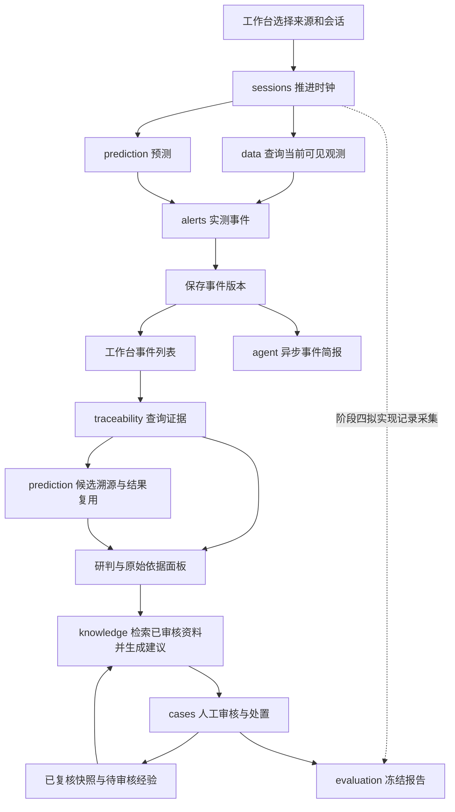

# 瓦斯风险智能体后续模块设计 v0.6

日期：2026-11-03。阶段目标：启用现有溯源，完成整体业务与展示设计，再按阶段实现。

本文件沿用一个 FastAPI 应用内的 10 个后端服务和 Vue 前端。职责分层、运行约束分别见[模块架构](architecture.md)、[模型封装](model-packaging.md)、[训练与聚类验算](training-and-clustering-audit-20261103.md)。前端视觉依据为[深蓝工作台设计 v0.3](design/v0.3/设计说明.md)。

## 1. 实现目标与当前基础

交付一套可操作、可追溯、可回放的工作台：查看监测与预测，选择事件，获取候选溯源和原始依据，检索规程，形成建议，记录人工审核与处置，最后生成冻结评估报告。

当前能力与本轮边界：

- 数据已包括 31002 原始 T0 历史源，以及 2022 年 1—2 月六通道加工源；六通道为 T0、风速、采煤机速度、采煤机甲烷、左电流、右电流。
- 六通道源有 50,480 个分钟时刻、302,880 条通道观测；原始 T0 源有 770,930 条观测。页面和报告分别标明时刻数与观测条数。
- 预测基线与 FEDformer＋12 阶段 LightGBM 专业模型已接入。当前默认使用基线，专业模型按模型编号显式选择；页面展示模型名称、版本和默认/实验属性。
- KMeans/SVC 候选溯源已启用。查询适用事件的证据时触发推理，同一事件版本、模型配置和输入标识复用运行结果；runner 负责监测、预测和事件计算。
- 深蓝工作台已迁移到正式 Vue，接通真实监测、指定版本预测、事件依据和候选溯源；操作及验收见[前端联动说明](frontend-linkage.md)。
- DeepSeek API 和八工具编排已接入，最多 5 轮、12 次工具调用。按2026-11-04确定的数据规则，真实来源在本机处理，云端仅使用包含合成观测、事件、预测、资料及处置的独立数据库；无需额外训练大模型。
- 现有新元31002工作面作业规程按用户2026-11-04确认暂作现行，后续新版本替换；正式资料入库后经人工审核用于检索和建议引用，研究草稿保留草稿性质。
- 当前阶段保持模型权重和效果口径，聚类修正、效果改进和真实成因标注列入后续研究。

## 2. 模块职责、接口与调用关系

表内 HTTP 路径均以 `/api` 为前缀；“拟新增”表示后续设计，尚未作为已实现能力。

| 模块 | 输入与职责 | 输出 | 现有 HTTP 接口 | 主要调用关系及后续工作 |
| --- | --- | --- | --- | --- |
| auth | 登录凭据、令牌；校验角色及工作面权限 | Actor、访问范围、登录状态 | `POST /auth/login`、`GET /auth/me`、`POST /auth/logout` | 所有业务入口调用；前端按身份显示操作 |
| data | 上传文件、列映射或标准现场读数；点位映射、质量检查、时钟内查询 | 数据源、点位、观测、质量标志及原始行引用 | `GET/POST /sources`、`GET/POST /points`、`POST /files`、`POST /history-imports`、`POST /ingest`、`GET /observations` | 为 sessions、prediction、alerts、traceability 提供数据；后续接现场协议适配 |
| sessions | 来源、模式、起始时刻、速度、会话动作；维护单调数据时钟 | 会话、执行上下文、一次推进结果 | `GET/POST /sessions`、`GET /sessions/{session_id}`、`POST /sessions/{session_id}/actions`、`POST /sessions/{session_id}/tick` | runner 调用 data、prediction、alerts；事件提交后触发去重的后台简报任务 |
| prediction | 会话、测点、模型版本、闭合历史窗口；预测及候选溯源运行 | 预测序列、候选类别、运行编号、输入引用、缺失字段 | `GET/POST /models`、`GET /model-packages`、`POST /model-package-runs`、`GET /model-package-runs/{run_id}`、`POST /forecasts`、`GET /forecasts/{run_id}` | 读取 data，通过本地模型运行环境推理；traceability 调用事件候选溯源 |
| alerts | 有效观测或物理浓度预测、规则版本；识别并修订事件 | 事件编号、类型、等级、状态、版本及证据引用 | `GET /rules`、`GET /events` | runner 调用判断；traceability、cases 读取事件快照；当前规则接口为查询 |
| traceability | 当前会话、事件编号及可选事件版本；冻结证据并触发适用的候选溯源 | 观测片段、预测运行、规则、候选溯源、缺失字段 | `GET /evidence` | 调用 alerts、data、prediction；作为页面和智能体统一证据入口 |
| knowledge | 原件、资料元数据、正文片段、审核结论、检索词、事件及引用编号 | 当前有效引用、建议版本、审核经验 | `POST /references/files`、`GET /references/files/{file_id}`、`GET /references/files/{file_id}/content`、`GET /references`、`POST /references/imports`、`GET /references/{entry_id}`、`POST /references/{entry_id}/review`、`POST /references/search`、`POST /advice`、`POST /experiences`、`POST /experiences/{experience_id}/review` | 本地上传与原文定位、审核及版本替代；读取事件依据及已复核处置快照 |
| cases | 事件、人工动作、建议编号与版本、执行及反馈内容 | 处置阶段、动作历史、建议审核状态、待办、复核快照 | `GET /cases/{event_id}`、`POST /cases/{event_id}/actions` | 调用 alerts、knowledge、auth；供前端操作和 agent 查询 |
| agent | 用户问题或事件简报任务；服务端注入身份、来源和时钟 | 回答、工具步骤、结果卡、引用、任务状态及审计 | `POST /chat`、`GET /tasks/{task_id}`、`POST /tasks/{task_id}/cancel`、`GET/POST /events/{event_id}/brief`、`POST /events/{event_id}/brief/cancel` | 对话编排八工具；主动简报限定四个只读工具并展示引用 |
| evaluation | 冻结数据清单、事件、样本、任务和有效监测时长 | 清单哈希、匹配明细、指标分子分母和报告 | `GET/POST /evaluations`、`GET /evaluations/{evaluation_id}` | 读取冻结记录；后续在本服务内增加会话记录采集器 |
| frontend | 登录态、当前会话、选中测点/事件、各模块返回值 | 综合态势、事件研判、处置、资料、评估页面 | 调用上述 HTTP 接口 | 统一联动状态、时间和版本；迁移深蓝设计并接真实数据 |

接口以运行服务的 `/openapi.json` 为准。现有兼容别名继续保留，页面优先使用表内主路径；请求与响应沿用实际接口合同。

## 3. 上下文与输入输出约定

服务端维护 `actor/source_id/session_id/mode/as_of`，工具参数和前端显示值不能改变授权范围及可见数据时间。

| 对象 | 必须关联的输入 | 下游使用的输出 |
| --- | --- | --- |
| 监测序列 | source_id、point_id、查询区间、as_of | event_time、available_at、值、单位、质量标志、文件/行引用 |
| 预测运行 | session_id、point_id、model_id/version、闭合窗口 | run_id、状态、预测区间、输出语义、模型版本、input_refs |
| 事件快照 | 来源、测点、规则及观测/预测依据 | event_id、event_revision、revision_as_of、event_type、alert_level、event_state |
| 候选溯源 | 事件快照、适用模型、目标观测、六通道窗口 | run_id、candidate_causes、cluster_probabilities、model_version、target_time、input_as_of、input_refs、reused |
| 建议版本 | 当前事件、已审核 reference_ids | advice_id、version、引用片段及定位、data_as_of、operation_context |
| 人工动作 | 当前事件、action_type、内容；审核/执行关联建议版本 | actor_id、occurred_at、data_as_of、阶段、动作编号 |
| 评估报告 | 冻结来源、时间范围、模型/规则版本和记录 | 清单及哈希、样本数量、事件匹配、指标分子分母、缺失项 |

六通道候选溯源仅处理适用的实测事件：目标观测达到模型阈值 0.65，输入为截止目标时刻前 300 秒的 61 个分钟时刻。缺少通道、窗口或绑定时返回具体缺失字段。类别概率按聚类成员概率展示，候选类别与真实成因标签分别记录。

前端以 `session_id/source_id/point_id/event_id/event_revision/as_of` 作为联动状态。查询范围按现有 `[start_at,end_at)` 语义处理，观测时间和可用时间均受 as_of 限制。事件版本更新后，页面重新获取其证据与建议状态。

## 4. 端到端调用链

1. 导入：文件上传→历史列映射→数据检查→来源和点位登记→观测查询；现场适配器最终写入同一标准观测入口。
2. 监测：推进会话→实测判断＋预测→事件版本入库→页面刷新。相同会话、时钟和输入配置的重复推进复用已有结果。
3. 研判：选择事件→查询指定版本的证据→适用时执行或复用候选溯源→显示原始片段、规则、模型与候选结果。
4. 智能体：提交问题→八工具任务→结果卡和引用；工具通过已有服务读取同一会话上下文。
5. 处置：检索资料→生成建议版本→人工审核→登记执行→提交反馈→复核→冻结快照→经验审核。
6. 评估：选择会话、范围和模型→采集运行记录→冻结清单→计算报告→从指标回查事件与原始依据。

## 5. 事件、任务与人工状态

事件状态沿用 `new/upgraded/ended`。事件变化产生不可变修订；事件结束与人工处置归档分别显示。

| 人工阶段 | 入口动作 | 必要条件与结果 |
| --- | --- | --- |
| new → confirmed | confirm_event | 授权人员确认事件并填写内容 |
| confirmed → advice_reviewed | review_advice | 关联具体 advice_id/version，结论为 approved 或 rejected |
| advice_reviewed → executed | record_execution | 关联已批准的建议版本，填写执行情况 |
| executed → feedback_submitted | submit_feedback | 填写执行反馈 |
| feedback_submitted → reviewed | review_case | 人工复核并冻结处置快照 |

前端根据 `pending_items`、建议版本审核状态和登录角色显示按钮；拒绝建议后可生成新版本再审。历史和模拟会话的动作记录为 `rehearsal`，现场记录使用 `field_record`，经验继承该性质。

任务使用现有异步提交、查询和取消接口。界面区分排队、执行、完成、失败及取消，保留实际返回的步骤和结果卡。人工审核、执行、反馈和复核由 cases 接口完成。

## 6. 智能体与主动简报设计

八工具保持为 `query_series`、`run_prediction`、`get_forecast`、`query_events`、`get_event_evidence`、`search_documents`、`draft_advice`、`get_case`。

| 交互任务 | 工具组合 | 页面结果 |
| --- | --- | --- |
| 查看监测与未来趋势 | query_series → run_prediction/get_forecast | 历史曲线、预测曲线、质量和模型版本 |
| 解释指定预警 | query_events → get_event_evidence | 事件原因说明、候选类别、规则和输入引用 |
| 查阅规程并起草建议 | get_event_evidence → search_documents → draft_advice | 可打开的规程片段、建议版本和审核入口 |
| 查询处置进展 | get_case | 当前阶段、已审核建议、执行反馈及待办 |

主动研判任务已实现：事件提交成功后，sessions 向 agent 提交异步任务；新事件和等级升级各对应冻结修订。事件和等级先显示，纯合成隔离来源随后生成DeepSeek简报，真实来源保留本机依据。普通对话和主动简报共用 `EVENT_BRIEF_ALLOWED_SOURCE_IDS`，生产保持空列表；真实来源不进入云端，本地大模型尚未部署。

简报保存事件编号/版本、会话、来源、as_of、模型/规则版本、证据引用、任务编号和生成状态。相同键复用结果；失败时保留结构化事件信息并支持人工重试。任务通过现有证据入口读取候选溯源，沿用其缓存规则。

**已实现接口**：`GET /api/events/{event_id}/brief?session_id=...&event_revision=...` 读取指定版本简报；`POST /api/events/{event_id}/brief` 请求生成或重试；`POST /api/events/{event_id}/brief/cancel`取消。身份与事件可见性由服务端验证。普通修订可查看同等级的较早版本，显示版本差异；实现及验收见[主动简报说明](event-briefs.md)。

## 7. 资料、建议与人工闭环设计

资料页已贯通资料清单、原件上传、原文片段、审核记录和经验记录。登记标题、来源、版本、适用工作面与页段定位，资料初始待审，审核通过后参与检索；现有新元31002作业规程按用户确认暂作现行，后续新版本替换。

**已实现接口**：`POST /api/references/files`接收20MiB以内的PDF、DOCX、TXT或MD原件；`GET /api/references/files/{file_id}`与`GET /api/references/files/{file_id}/content`读取元数据及原件；`POST /api/references/imports`接受`file_id`并兼容内联原文。服务保存SHA-256，分段保留物理页码、段号、表格或行号定位。监测CSV/XLSX继续使用`/api/files`。

检索采用已审核资料的本地多关键词文本匹配，按服务器当前时间核验有效期。尚未生效的资料不能批准；同一`entry_id`的新版本审核通过后，旧版标为`superseded`，保留历史引用但不进入新建议。界面展示命中片段、来源、版本、范围和定位；`POST /api/advice`生成具体建议版本，分别记录事件`data_as_of`和当前资料`knowledge_as_of`。

处置详情一次查询返回建议版本、审核结论、动作历史、`pending_items`、`advice_validity`及`reviewed_snapshot`。建议审核和执行绑定具体版本及当前事件修订，并重新校验引用资料当前有效、未被替代；过时建议需重新生成并审核。每次动作记录事件快照；复核后冻结会话、来源、事件修订、执行建议和引用，基于该快照提交经验审核。经验继承现场或演练性质，演练经验不进入实时现场建议。

本阶段已完成“资料导入→审核→检索→引用→建议审核→执行→反馈→复核→经验审核”的隔离HTTP全链验收。实际原件的解析与入库验证保持待审，正式条文审核由业务人员完成。材料包、接口和验收范围见[知识库与人工闭环说明](knowledge-cases.md)。

## 8. 竞赛展示与回放评估

正式工作台采用深蓝设计稿的顶部总览、左侧测点与质量、中部工作面与趋势、右侧研判/依据/处置、底部事件记录布局。显示真实业务名称、单位、时间和来源；会话模式放在状态区。

| 展示场景 | 数据与操作 | 可验证结果 |
| --- | --- | --- |
| 日常监测与预测 | 选取已接通的 31002 六通道历史区间，切换测点和模型 | 曲线、数值、数据截止时间和模型版本一致 |
| 事件研判 | 选择实际生成且满足模型输入的事件 | 联动到对应窗口，展示候选类别、依据和输入截止时刻 |
| 质量与失败状态 | 选择缺失窗口或隔离演练中的接口失败场景 | 显示具体缺失/失败项，已有事件与结果继续可查 |
| 人工处置 | 使用同一事件和已审核作业规程完成演练 | 建议版本审核、执行、反馈、复核记录完整 |
| 回放与报告 | 暂停、继续、变速，按固定清单重新回放 | 事件与证据可复现，报告可回查匹配明细 |

回放入口使用现有 sessions 能力；向过去重新回放时按现有会话规则创建新会话并保留关联。场景清单保存来源、时间区间、测点、模型和规则版本，区分真实历史与合成演练。

当前六通道数据 T0 最高值为 0.75，缺少 ≥0.8 的真实正例。模型目标阈值 0.65、各级业务规则及其适用事件分别说明；无正例口径显示样本数量和不可计算项。界面采用实际事件等级，合成高值演练使用独立来源。

评估服务已有冻结和报告能力；后续增加内部会话记录采集器，将实际运行转换为 actual_events、alert_events、samples、tasks 和 valid_monitoring_hours。**拟新增接口**：`POST /api/evaluations/from-session`，输入 session_id、时间范围、测点及模型选择，返回冻结评估编号。

报告展示数据范围、训练/测试分区、模型/规则版本、有效时长、事件匹配、指标分子分母、缺失项与清单哈希。预测误差、事件检出与聚类标签一致率分别报告；真实成因效果待具备对应标注后计算。

## 9. 实现顺序与完成标准

各阶段先写相应失败测试，再实现接口或交互；完成该阶段回归、页面检查和可复现验收后推进下一阶段。

| 阶段 | 实现范围 | 完成标准 |
| --- | --- | --- |
| 一：正式前端联动 | 深蓝设计迁移；会话、测点、曲线、事件、候选溯源、依据及任务卡 | 主要页面真实 API 联动；切换来源/事件不残留旧结果；常用窗口与窄屏下内容可读、操作可达 |
| 二：智能体主动简报 | 四类业务交互、事件版本简报、步骤/引用、失败重试和取消 | 同一事件版本结果复用；引用可打开；失败保留已完成卡片；取消阻止后续工具调用 |
| 三：知识与人工闭环 | 作业规程入库审核、建议版本、五类人工动作、经验审核 | 全链可操作；被拒绝建议无法登记执行；复核记录冻结；权限和来源性质验证通过 |
| 四：回放与评估 | 固定场景、会话采集、冻结报告及明细联查 | 重复回放遵守时钟；无未来数据；报告与冻结记录一致；无正例和缺失项按实际口径展示 |
| 五：现场接口 | 现场协议转换、来源/测点绑定、重试去重和运行状态 | 实际接口样本入库并查询成功；断线补传和重复发送验证通过；现场会话受服务器时钟约束 |

现场阶段需要提供：接口协议与认证方式、访问网络、点位编号和单位、采样/上传周期。正式规则与建议发布还需核对矿井有效规则、作业规程版本和审核权限；现有作业规程先进入资料审核流程。

本文件确定模块设计和验收顺序；当前代码状态以[实现记录](implementation-status.md)及实际接口为准。环境、权重、数据和运行产物沿用 F 盘目录，GitHub 同步源码与文档。
